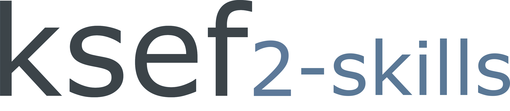

<h1 align="center">ksef2-skills: Agent Skills for KSeF 2.0</h1>

<h3 align="center">
  Teach your AI assistant to work with the ksef2 SDK and CLI tools that allow integrating with the KSeF 2.0 API.
</h3>

<p align="center">
  CLI workflows, Python SDK integration, authentication, and bot integration<br>
  through the ksef2 SDK and ksef2-cli.
</p>

<div align="center">
  <br>
  <a href="skills/ksef2/SKILL.md" title="ksef2 Agent Skill">
    <picture>
      <source media="(prefers-color-scheme: dark)" srcset="assets/logo/ksef2-skills-light-logo.png">
      
    </picture>
  </a>
  <br>
  <br>
  <p>
    <a href="https://skills.sh/stacking-hq/ksef2-skills/ksef2"></a>
    <a href="LICENSE"></a>
  </p>
  <p>
    <a href="#install">Install</a> ·
    <a href="#use">Use</a> ·
    <a href="https://github.com/stacking-hq/ksef2">Python SDK</a> ·
    <a href="https://github.com/stacking-hq/ksef2-cli">CLI</a>
  </p>
</div>

## What is ksef2-skills?

`ksef2-skills` provides a skills.sh-compatible [Agent Skill](skills/ksef2/SKILL.md)
for Poland's National e-Invoicing System, KSeF 2.0. It teaches Grok, Codex,
Claude, and other assistants that load standard `SKILL.md` packages to use the
[`ksef2`](https://github.com/stacking-hq/ksef2) Python SDK and
[`ksef2-cli`](https://github.com/stacking-hq/ksef2-cli).

The skill covers:

- CLI usage: queries, exit codes, pagination, `--wait`/receipt workflows
- SDK/API integration: stable imports, async handles, retries, error handling
- Authentication & security: methods, secrets, profiles, environments
- Bot integration: host prerequisites, tenant authorization, safe reporting

The skill is **documentation, not runtime**: it ships no tools, no credentials,
and no network access. Its content is pinned to upstream commits in
[`skills/ksef2/provenance.md`](skills/ksef2/provenance.md).

## Install

```bash
npx skills add stacking-hq/ksef2-skills --skill ksef2
```

The skills CLI installs into your agent's skills directory
(`.claude/skills/`, `.codex/skills/`, `.grok/skills/`, `.agents/skills/`, …).
Or copy it manually:

```bash
git clone https://github.com/stacking-hq/ksef2-skills
cp -r ksef2-skills/skills/ksef2 ~/.agents/skills/    # or your agent's skills dir
```

**Runtime prerequisites** (the skill does not provide these):

```bash
# Python 3.12+
uv tool install ksef2-cli        # CLI: ksef2 / ksef2-cli
pip install ksef2                # or: uv add ksef2
```

Configure credentials locally — a `ksef2` profile or `KSEF2_*` environment
variables. The agent works in the configured profile and never needs secret
values in chat.

## Use

The agent loads the skill when a task mentions KSeF, `ksef2`, `ksef2-cli`,
FA(3)/FA3 invoices, UPO, invoice metadata, or exports. Invoke it explicitly
with `$ksef2`.

## Layout

```text
skills/ksef2/                The installed skill
├── SKILL.md                 Entrypoint: operating rules + routing
├── references/
│   ├── cli.md               ksef2-cli commands, output, FA(3) drafts, async
│   ├── sdk-api.md           ksef2 SDK imports, clients, handles, retries, errors
│   ├── auth-security.md     credentials, secrets, profiles, environments
│   └── bot-integration.md   assistant/bot integration
└── provenance.md            pinned source SHAs, offline checks, limitations
evals/prompts.md             For maintainers: 11 eval prompts, not installed
```

## Evaluate

[`evals/prompts.md`](evals/prompts.md) contains 11 realistic prompts with
pass/fail criteria for checking the skill after a change. Give an agent the
skill plus one prompt in a scratch workspace; do not include the criteria in
the prompt.

## Publish

[skills.sh](https://skills.sh) indexes public repositories installed through
the skills CLI; no separate submission is needed. Keep
`skills/ksef2/SKILL.md` at that path, and update the pins in
[provenance.md](skills/ksef2/provenance.md) when upstream moves.

## License

[MIT](LICENSE)
